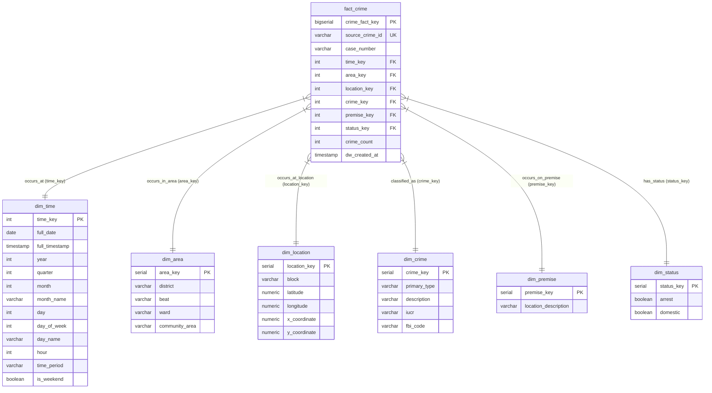

# 📐 CrimeLens Data Warehouse - Star Schema Architecture & Specification

> **Database Engine**: PostgreSQL 15+ / 18  
> **Database Name**: `crimelens_db`  
> **Schema Pattern**: Star Schema (Kimball Methodology)  
> **Target Dataset**: Official Chicago Crimes (2023–2024 Sample)  

---

## 1. Executive Overview & Fact Table Grain

### **Fact Table Grain Definition**
> **Grain**: One row in `fact_crime` represents **exactly ONE unique reported crime incident** recorded by the Chicago Police Department.

The data warehouse employs a **Star Schema** architecture optimized for high-performance multi-dimensional OLAP queries, spatial density clustering (DBSCAN), and pattern mining.

---

## 2. Mermaid Star Schema Entity-Relationship Diagram

---

## 3. Dimensional Model Specifications & Justifications

### 3.1 `dim_time` (Temporal Dimension)
* **Purpose**: Supports temporal trend analysis, seasonality detection, diurnal pattern mining, and time-based OLAP aggregations.
* **Granularity**: Date + Hour (Formatted as `YYYYMMDDHH`).
* **Attributes**:
  * `time_key` (PK, INT): Format `2023010100` for 2023-01-01 00:00.
  * `full_date` (DATE): Incident calendar date.
  * `full_timestamp` (TIMESTAMP): Complete incident date and time.
  * `year` (INT): Calendar year (`2023`, `2024`).
  * `quarter` (INT): Fiscal/calendar quarter (`1` to `4`).
  * `month` (INT) / `month_name` (VARCHAR): Month representation (`1` = January).
  * `day` (INT) / `day_of_week` (INT) / `day_name` (VARCHAR): Day hierarchy.
  * `hour` (INT): Incident hour (`0` to `23`).
  * `time_period` (VARCHAR): Operational police shift (`Morning`, `Afternoon`, `Evening`, `Night`).
  * `is_weekend` (BOOLEAN): Weekend flag (`TRUE` for Saturday/Sunday).

---

### 3.2 `dim_area` (Administrative Zonal Dimension)
* **Purpose**: Enables administrative risk ranking, precinct comparison, and police resource allocation.
* **Attributes**:
  * `area_key` (PK, SERIAL): Surrogate key.
  * `district` (VARCHAR): Chicago Police District ID (e.g., `008`).
  * `beat` (VARCHAR): Police Patrol Beat ID (e.g., `0834`).
  * `ward` (VARCHAR): City Council Ward ID (e.g., `18`).
  * `community_area` (VARCHAR): Official Chicago Community Area ID (e.g., `70`).

---

### 3.3 `dim_location` (Geographic Coordinates & Spatial Dimension)
* **Purpose**: Houses WGS84 spatial coordinates and block addresses for Leaflet map visualizations and DBSCAN spatial density clustering.
* **Attributes**:
  * `location_key` (PK, SERIAL): Surrogate key.
  * `block` (VARCHAR): Anonymized street block address (e.g., `079XX S KOMENSKY AVE`).
  * `latitude` (NUMERIC(10, 8)): WGS84 Latitude coordinate.
  * `longitude` (NUMERIC(11, 8)): WGS84 Longitude coordinate.
  * `x_coordinate` / `y_coordinate` (NUMERIC): Illinois State Plane projection coordinates.

---

### 3.4 `dim_crime` (Offense Classification Taxonomy Dimension)
* **Purpose**: Categorizes crime types for categorical distribution charts, Apriori co-occurrence rules, and law enforcement offense metrics.
* **Attributes**:
  * `crime_key` (PK, SERIAL): Surrogate key.
  * `primary_type` (VARCHAR): Major offense type (e.g., `THEFT`, `BATTERY`, `WEAPONS VIOLATION`).
  * `description` (VARCHAR): Offense sub-category (e.g., `RECKLESS FIREARM DISCHARGE`).
  * `iucr` (VARCHAR): Illinois Uniform Crime Reporting code (4-digit code).
  * `fbi_code` (VARCHAR): FBI crime classification code.

---

### 3.5 `dim_premise` (Setting & Environment Dimension)
* **Purpose**: Analyzes crime vulnerability across physical settings.
* **Attributes**:
  * `premise_key` (PK, SERIAL): Surrogate key.
  * `location_description` (VARCHAR): Physical premise setting (e.g., `STREET`, `RESIDENCE`, `ALLEY`, `APARTMENT`, `SIDEWALK`).

---

### 3.6 `dim_status` (Operational Incident Status Dimension)
* **Purpose**: Tracks operational outcomes and domestic context.
* **Attributes**:
  * `status_key` (PK, SERIAL): Surrogate key.
  * `arrest` (BOOLEAN): Flag indicating if an arrest was made.
  * `domestic` (BOOLEAN): Flag indicating if the incident was domestic-related.

---

### 3.7 `fact_crime` (Transactional Fact Table)
* **Purpose**: Stores individual incident measures linked to dimensions.
* **Attributes**:
  * `crime_fact_key` (PK, BIGSERIAL): Fact surrogate primary key.
  * `source_crime_id` (VARCHAR, UNIQUE): Unique source crime ID from raw dataset.
  * `case_number` (VARCHAR): Chicago Police Department Case Number.
  * `time_key` / `area_key` / `location_key` / `crime_key` / `premise_key` / `status_key` (FKs): Foreign keys to dimension tables.
  * `crime_count` (INT, DEFAULT 1): Fully additive measure set to `1` for each crime incident event.
  * `dw_created_at` (TIMESTAMP): Record insertion timestamp into data warehouse.

---

## 4. Handling Missing & Null Values (Data Quality Assurance)

To ensure no valid crime incident records are dropped during ETL due to missing attributes:
* **Default UNKNOWN Rows**: Every dimension table pre-populates a default row with `key = 0`.
  * `dim_location`: `location_key = 0` (`block = 'UNKNOWN_LOCATION'`, `latitude = NULL`, `longitude = NULL`).
  * `dim_premise`: `premise_key = 0` (`location_description = 'UNKNOWN_PREMISE'`).
  * `dim_area`: `area_key = 0` (`district = 'UNKNOWN'`, `community_area = 'UNKNOWN'`).
* **Zero Incident Loss**: Incidents with unassigned coordinates (~9.47% of raw dataset) link to `location_key = 0` in `fact_crime` without triggering foreign key constraint violations.

---

## 5. Support for OLAP Multi-Dimensional Operations

| OLAP Operation | SQL / Schema Execution Mechanism |
| :--- | :--- |
| **Roll-Up** | Aggregating `SUM(crime_count)` from `dim_time.hour` $\rightarrow$ `dim_time.month` $\rightarrow$ `dim_time.year`, or `dim_area.beat` $\rightarrow$ `dim_area.district`. |
| **Drill-Down** | Navigating from annual city totals down to hourly precinct activity (`dim_time.hour` and `dim_area.beat`). |
| **Slice** | Filtering fact rows by a single dimension member (e.g., `WHERE dim_time.year = 2024`). |
| **Dice** | Subsetting across multiple dimensions (e.g., `WHERE dim_time.year = 2024 AND dim_crime.primary_type = 'ROBBERY' AND dim_status.arrest = TRUE`). |
| **Pivot** | Cross-tabulating `dim_crime.primary_type` against `dim_time.month_name` using `SUM(crime_count)`. |

---

## 6. Dataset Limitations & Schema Boundaries
1. **Victim Demographics**: Victim age, victim gender, and victim race are not published in the official Chicago open dataset and are excluded from the schema.
2. **Suspect Demographics**: Suspect age and gender are omitted from the source data.
3. **Monetary Damage**: Financial loss values are not recorded in raw incident logs.
